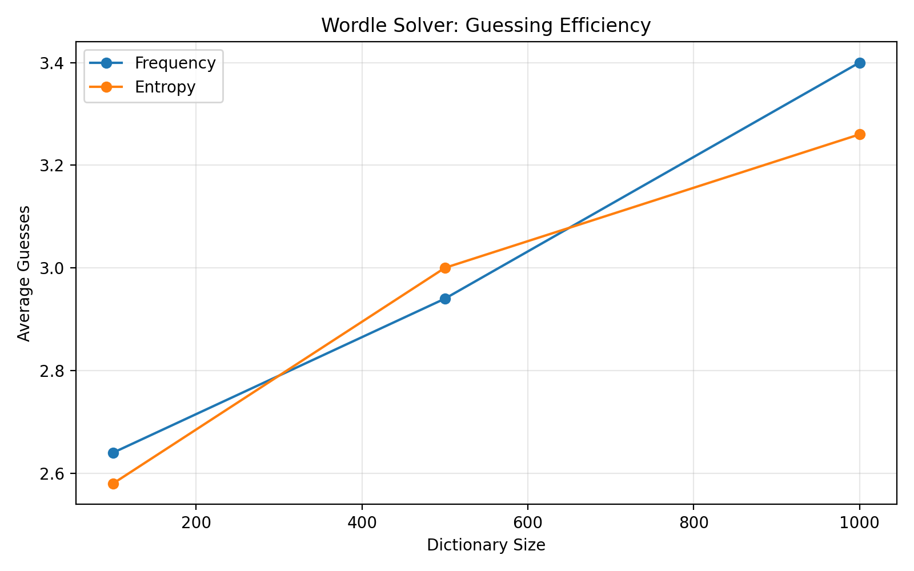
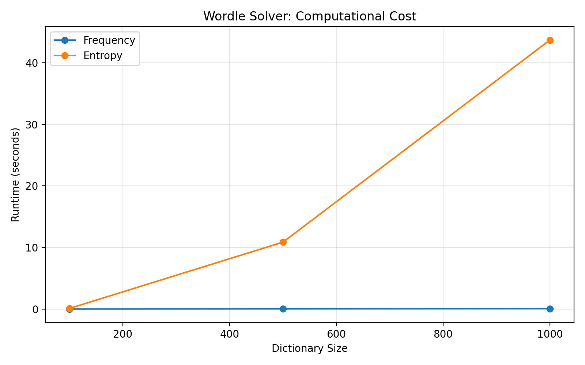

# Wordle Solver: Frequency vs. Entropy-Based Strategies

A Python-based Wordle solver that implements and compares two word recommendation algorithms: letter frequency and information entropy.

## Project Overview

This project explores how different word selection strategies affect Wordle solving efficiency and computational performance.

The solver supports Wordle feedback generation, candidate filtering, automated gameplay, benchmarking, and performance visualization.

## Algorithms

### 1. Letter Frequency Strategy

Ranks candidate words based on the frequencies of their unique letters among remaining possible answers.

### 2. Information Entropy Strategy

Evaluates candidate guesses based on the expected information gained from their possible feedback patterns.

The implementation also includes tie-breaking rules, feedback caching, and an early-stopping condition.

## Experimental Results

Both algorithms were evaluated on randomly sampled dictionaries containing 100, 500, and 1,000 words, with 50 games per dictionary size.

| Dictionary Size | Frequency Avg. Guesses | Entropy Avg. Guesses |
|---|---:|---:|
| 100 | 2.64 | 2.58 |
| 500 | 2.94 | 3.00 |
| 1,000 | 3.40 | 3.26 |

Both strategies achieved a 100% win rate in these experiments.

### Guessing Efficiency



### Computational Performance



## Key Findings

- Both strategies successfully solved all 50 sampled games at each dictionary size.
- Entropy achieved slightly lower average guess counts in the 100-word and 1,000-word experiments, while frequency performed better at 500 words.
- Entropy-based recommendations required substantially more computation.
- An early-stopping optimization preserved guessing performance but did not produce a meaningful runtime improvement in larger dictionaries.

These results are preliminary and based on limited random samples rather than the official Wordle answer distribution.

## Technologies

Python, Pandas, Matplotlib, Information Theory, Algorithm Benchmarking

## How to Run

Install dependencies:

```bash
python3 -m pip install -r requirements.txt
```

Play Wordle:

```bash
python3 game.py
```

Run the algorithm comparison:

```bash
python3 experiment.py
```

Generate performance visualizations:

```bash
python3 visualize.py
```

## Future Improvements

- Optimize entropy computation and candidate selection.
- Evaluate performance across multiple random seeds.
- Introduce larger and more representative answer dictionaries.
- Add statistical comparisons and more comprehensive benchmarks.

## Word List

The word list is sourced from the [tabatkins/wordle-list](https://github.com/tabatkins/wordle-list) project. Refer to the original repository for source information and applicable usage terms.